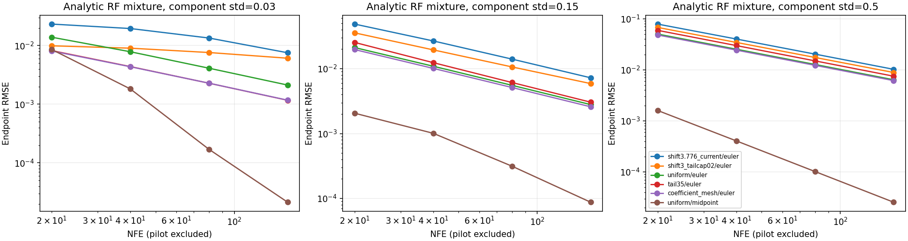

# Bounded validation of sampling methods after a VAE swap

Date: 2026-10-12. Scope: numerical integration design and **Anima with a Qwen
2.1 VAE**. No long training or final model-quality acceptance was performed.
The Original Anima model was not tested for a defect in this task.

## Established contracts

The released Qwen 2.1 scheduler config and source pipeline at Diffusers
`6256aa7` were inspected. Packing, unpacking, latent preparation, shift function
and timesteps calls match SushiUI by AST. Dynamic shifting uses actual unpatched
image-token count and model configuration overrides: base length 256, max length
8192, base/max mu 0.5/0.9, exponential time shift, terminal positive sigma 0.02.

Anima's upstream sd-scripts sampler and ComfyUI integration use shift 3.
SushiUI's separate latent-area shift heuristic is a code discrepancy, not a
measurement of Original Anima quality. At 1472x896/40 evaluations it gives
shift 51.676 with the native 8x codec and 3.776 with the swapped 16x codec.
The last model evaluation is at sigma 0.570 or 0.088 respectively. This confirms
that swap actually reduces that shift; the native-codec discrepancy must not
be presented as the diagnosed cause of the swap version's jaggies.

[CPU sigma grids](data/anima_qwen_schedule_grids_2026-10.json).
Earlier real-codec/head, attention-gradient and dense known-target loop evidence
is summarized in [the Anima partition guide](../guides/ANIMA_PARTITION_TRAINING_DESIGN.md)
and [attention audit](ANIMA_OWNER176_ATTENTION_PRECISION_2026-10.md).

## New CPU oracle experiment

Use the exact marginal rectified-flow velocity for an equal two-Gaussian mixture
with means -1/+1, component standard deviation 0.03, 0.15 or 0.5, and independent
standard Gaussian initial noise. The endpoint in one dimension is the monotonic
transport `F_clean^-1(Phi(initial_noise))`, obtained by CDF bisection independently
of a time integrator. Maximum CDF residual is 1.45e-15. All arms start with the
same 256 BF16-representable noise values, seed 721.

Compare nine grid policies, Euler/midpoint, and budgets 20/40/80/160: **216 arms**.
Every trajectory is finite, strictly decreasing from sigma 1 to exact zero,
and uses the stated NFE. Midpoint uses half as many intervals for the same NFE.
Pilot calibration is not hidden in that budget: the prototype's coefficient mesh
costs an extra 48 Euler or 120 midpoint evaluations per trajectory. Neither its
quality nor its calibration cost should be generalized to the real DiT.

Selected endpoint RMSE at **40 integration NFE**:

| Component std | Current swap shift/Euler | Uniform/Euler | Clean 35%/Euler | Uniform/midpoint | Coefficient mesh/midpoint |
|---|---:|---:|---:|---:|---:|
| 0.03 | 0.019540 | 0.007854 | 0.004387 | 0.001825 | 0.000134 |
| 0.15 | 0.026805 | 0.010922 | 0.012400 | 0.001010 | 0.000245 |
| 0.50 | 0.040106 | 0.025322 | 0.029838 | 0.000406 | 0.000195 |

More clean coverage helps the narrow fixture but can be worse than uniform in
broader ones. This is a counterexample to one universal clean-heavy schedule,
not an estimate of Qwen decoder statistics. A fixed positive terminal value also
retains a finite last interval as NFE increases; a proposed *upper bound* should
not enlarge a native interval already smaller than that bound.

Twenty-four controls isolate state rounding and a deliberately biased velocity
field. At std 0.03, unbiased uniform Euler errors at 40/80/160/640 NFE are:

| State | 40 | 80 | 160 | 640 |
|---|---:|---:|---:|---:|
| BF16 | 0.007231 | 0.003644 | 0.010951 | 0.072493 |
| FP32 | 0.007854 | 0.004115 | 0.002122 | 0.000545 |

BF16 happens to benefit from cancellation at the first two budgets, then
deteriorates. Persistent FP32 state avoids that failure in this fixture; the
field itself is analytic, not a BF16 neural model. With a smooth injected field
bias, FP32 errors approach 0.01020 despite 640 NFE. Finer steps cannot repair that
model-error component. An invertible synthetic decoder with gain 32 also confirms
that small latent errors can be magnified in a sensitive output direction; this
does not measure the actual Qwen decoder Jacobian.

[All oracle results](data/vae_swap_schedule_oracle_2026-10.json).
Reproduce without model loads or CUDA via
`venv/Scripts/python.exe examples/vae_swap_sampling_method_probe.py` on Windows,
or the repository POSIX venv equivalent. The script asserts CUDA was not
initialized and writes numerical results/plot under ignored `local/verification/`.

## New direct swapped-model inference comparison

Normally stop run 176, saving step **134052**. Load that exact checkpoint and
one API-revalidated rating:general image. Fit the target to 1472x896, use the
checkpoint's Qwen 2.1 64-channel/16x codec and Gaussian alignment, and freeze all
weights. No U-Net, CFG 1, seed 73, same BF16 initial state/noise across arms,
FP32 integration, BF16 model/timestep boundary, common FP32 codec decode.
The global adapter is not invoked because this is a full-frame path. There are
six trajectories: start sigma 0.2 or 1.0, each with 40 NFE:

- Current-shift shape with Euler.
- Euler with 35% of intervals below sigma 0.2.
- Midpoint with 35% of intervals below sigma 0.2, 20 intervals/40 NFE.

At start 0.2 the current-shift shape is scaled to the exact start to keep 40 NFE;
it is **not** the production img2img suffix selected by UI denoising strength.
At start 1 it is the production sigma shape, with FP32 state as a controlled
change. The callback uses production Anima, normalization and fixed-noise
alignment; the alternative integration loops are diagnostic prototypes, not
implemented public samplers. No extra training was performed.

| Start sigma | Policy | Latent distance to target | Pixel distance to codec reference | Edge distance to codec reference |
|---|---|---:|---:|---:|
| 0.2 | Current shape/Euler | 0.041052 | 0.003678 | 0.002541 |
| 0.2 | Clean-heavy/Euler | 0.041428 | 0.003727 | 0.002572 |
| 0.2 | Clean-heavy/midpoint | 0.041865 | 0.003778 | 0.002603 |
| 1.0 | Current shape/Euler | 1.616028 | 0.114429 | 0.008673 |
| 1.0 | Clean-heavy/Euler | 1.475738 | 0.087397 | 0.007254 |
| 1.0 | Clean-heavy/midpoint | 1.541417 | 0.098067 | 0.008241 |

Pixel/edge distances are mean squared RGB [0,1] differences, edges from adjacent
pixel differences. **Full-noise generation has no obligation to recreate the
known image**; composition/color changes affect these scores and they are not
quality rankings or proof of a faulty field. At sigma 0.2 preservation is a useful
bounded comparison but still not an exact conditional-transport ground truth.

Visual inspection: the low-noise reconstructions are similar; the alternatives
do not clearly improve their contours. Full-noise outputs change composition
and color but **all retain rough/jagged detail**. A second-order method that wins
on the oracle therefore cannot be promoted automatically on this real model.
The newer checkpoint is not the same as the earlier step-122519 loop audit, and
the owner has changed training exposure/global behavior in between; this is not
a controlled training-progress comparison.

Each 40-NFE trajectory took about 3.16-3.20 seconds and peaked at about 4.00GiB
allocated, excluding load, encoding and decoding. One run per arm, fixed order,
no confidence interval: this is only a bounded feasibility observation, not an
end-to-end speed or VRAM acceptance benchmark.

[Numerical real-model results](data/anima_qwen_swap_schedule_light_2026-10.json).
Images and private API scripts stay under ignored
`local/verification/vae_swap_schedule_real/`; no owner image, caption or raw
latent is committed. The permitted comparison is `comparison.png` there.
Run 176 was resumed from step 134052 with its parameters unchanged. Backend
production code, training distribution and public sampling settings were not
changed by this investigation.

## Verdict and deferred gates

The [sampling methodology design](../decisions/VAE_SWAP_SAMPLING_METHOD.md) is
**viable with caveats**. Accept the numerical contracts, proper baseline,
FP32 state, explicit NFE budget and compatible profile persistence. Treat
decoder-sensitive calibration and midpoint promotion as future bounded
real-model gates. Do not claim a fixed grid or solver resolves the swapped
model's jaggies. Adequate training under the correct target architecture/path,
long-term contour improvement and final sampler choice remain owner-run gates.
